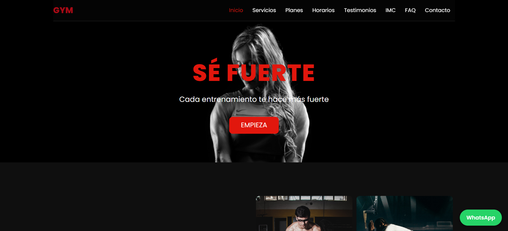

# GYM Fitness

Landing page responsive de un gimnasio **ficticio**, creada como proyecto de práctica de desarrollo web front end.

🔗 **Demo:** https://app.netlify.com/teams/edwinvidi/projects



## Funcionalidades

- Menú responsive con enlace activo según el scroll
- Planes y precios con botón "Elegir plan" que prellena el formulario
- Calculadora de IMC con validación de datos
- Formulario de contacto funcional (Netlify Forms + honeypot anti-spam)
- FAQ desplegable accesible (`<details>`)
- Mapa de Google Maps integrado
- Botón flotante de WhatsApp
- Animaciones al hacer scroll (respeta `prefers-reduced-motion`)
- Diseño responsive (móvil, tablet, escritorio)

## Tecnologías

- HTML5 semántico
- CSS3 (Flexbox, media queries, variables de diseño propias)
- JavaScript (vanilla): IntersectionObserver, manipulación del DOM
- Netlify (despliegue y formularios)

## Estructura

```
├── index.html
├── style.css
├── script.js
└── Images/
```

## Ejecutar en local

```bash
git clone https://github.com/edvillamizar/proyecto-gym.git
cd proyecto-gym
# abrir index.html en el navegador
```

> El formulario solo funciona una vez desplegado en Netlify.

## Aviso

Proyecto de demostración. El gimnasio, los testimonios y los datos de contacto son ficticios.

## Autor

**Edwin Alejandro** · Desarrollador Web Front End Junior · Granada, España